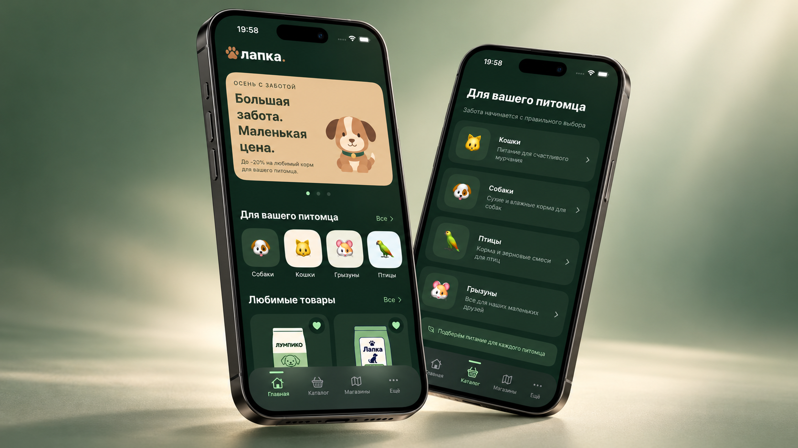

# Lapka · ZooShop

A native SwiftUI pet shop app with a Russian-language interface. Browse pet food, explore product details, save favorites, and find store information in light or dark mode.

The Xcode project and target are named **ZooShop**. Product data and images come from the separate [PetsAPI backend](https://github.com/t1geryan/PetsAPI).

## Features

- Home screen with promotions, pet categories, and favorite products.
- Catalog for dogs, cats, rodents, and birds, with product detail screens.
- Favorites persisted locally using Core Data.
- Store cards with contact details, opening hours, and time-zone-aware open/closed status. See [backend compatibility](#backend-compatibility).
- System, light, and dark appearance options with saved preferences.
- Remote images with memory/disk caching and shared in-flight requests.
- Loading, empty, and error states with retry actions.

The app focuses on browsing and favorites; checkout, payments, and user accounts are not implemented.

## Requirements

| Component | Requirement |
| --- | --- |
| IDE | Xcode 26.3 recommended |
| Deployment target | iOS 26.2+ |
| Run destination | iPhone Simulator or physical iPhone |
| Backend | JDK 21; Gradle wrapper included in PetsAPI |

The iOS target has no third-party package dependencies.

## Getting started

### 1. Clone both repositories

```sh
git clone https://github.com/rieKITO/ZooShop.git
git clone https://github.com/t1geryan/PetsAPI.git
```

The commands below assume this layout:

```text
Projects/
├── ZooShop/
└── PetsAPI/
```

### 2. Start PetsAPI

With JDK 21 installed, run:

```sh
cd PetsAPI
export JAVA_HOME=$(/usr/libexec/java_home -v 21)
chmod +x gradlew
./gradlew run
```

The first run downloads Gradle and dependencies. The server uses bundled product data and images, so no database or API key is required.

Keep the server running at **http://localhost:8080** while using the app. To verify it, run in another terminal:

```sh
curl --fail http://localhost:8080/products/
```

This returns a JSON array of products; the root URL has no route.

### Running on a physical iPhone

- Connect the Mac and iPhone to the same network and configure your development team under **Signing & Capabilities**.
- Set `APIConfiguration.baseURL` to the Mac's reachable hostname or LAN address, such as `http://your-mac.local:8080`. On an iPhone, `localhost` refers to the phone.
- Allow server connections through the Mac's firewall, grant local-network access if prompted, and run the **Debug** configuration.

If product images point to an unreachable host, restart PetsAPI with an explicit image base URL:

```sh
PUBLIC_BASE_URL=http://your-mac.local:8080 ./gradlew run
```

Local-network settings are provided by [`Debug-Info.plist`](Configuration/Debug-Info.plist). Release builds require a separately configured HTTPS backend.

## Backend compatibility

| Route | Purpose | Public PetsAPI status |
| --- | --- | --- |
| `GET /products/` | Product catalog | Implemented |
| `GET /images/{filename}` | Product images | Implemented |
| `GET /stores/` | Stores and opening hours | Implemented |


## Architecture

SwiftUI views use observable view models backed by protocol-based services. [`AppDI`](ZooShop/Core/DI/AppDI.swift) assembles production dependencies; preview implementations provide sample data.

| Layer | Responsibility |
| --- | --- |
| SwiftUI + Observation | Screens, navigation, and presentation state |
| Combine + URLSession | API requests, validation, and decoding |
| Core Data | Favorite product IDs |
| Image services | Fetching, request sharing, and memory/disk caching |
| UserDefaults | Appearance preferences |
| SwiftGen resources | Typed colors and localized strings |

Favorites persist locally, but product details still require the backend. Image caching does not provide a complete offline catalog.

```text
ZooShop/
├── Core/             # Dependency assembly, configuration, and themes
├── Extensions/       # Formatting helpers
├── Persistence/      # Core Data stack and model
├── PreviewContent/   # Sample repositories and services
├── Resources/        # Assets, localization, and generated accessors
├── Services/         # Catalog, stores, favorites, networking, and images
├── UIComponents/     # Reusable interface components
├── Views/            # Screens and view models
└── ZooShopApp.swift  # App entry point
ZooShopTests/         # Unit tests
Configuration/       # Debug local-network configuration
docs/images/         # README artwork
```
